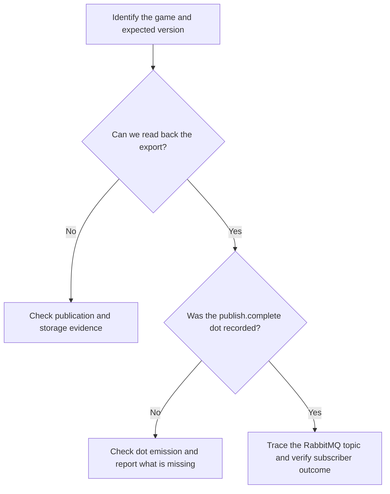

<!-- recur-trace-v1
defines: main.improvement.36
defines: main.improvement.36.ulu_prototype
defines: main.improvement.36.experience_packet
defines: main.improvement.36.specialist
defines: main.improvement.36.durable_experience
defines: main.improvement.36.specialist_coordination
defines: main.improvement.36.recursive_coordination
defines: main.improvement.36.validation
-->
# Recur Improvement 36: Project Experience Through Reveal

Date: 2026-11-19

Status: Working draft. ULU prototype verified locally. Native experience packets are proposed.

defines: main.improvement.36
consumes: recur.reveal.artifact-types recur.reveal.persona-skills main.improvement.34 main.improvement.35

## Intent

Give a model starting on an unfamiliar project access to **specialized experience**:
what people and agents have already tried, what they observed, which skills they
used together, and how to tell whether the lesson still applies. A team should
be able to hand that experience to a fresh model through the project checkout.

A skill such as `recur-trace-id` teaches the model how to follow an identifier.
The ULU publishing experience tells it to inspect the exported game first,
then follow `publish.complete` through DotWatcher to
`ulu.topic.dot.ownership.distribute`. A game export and a RabbitMQ delivery
answer different questions. That distinction comes from a run in which the
export was verified and the same run recorded downstream MongoDB errors.

| Artifact | Question it answers |
| --- | --- |
| Skill | How do I perform this kind of work? |
| Persona | What perspective and guidance should I bring to the work? |
| Experience | What happened in this project or domain, when does it apply, and which skills and evidence should I bring into context? |
| Specialist | Which experiences can I draw on for this family of problems, and how do I choose or combine them for the task at hand? |

## ULU prototype

defines: main.improvement.36.ulu_prototype

In User Level Up, `docs/ulu.recur.md` declares `artifact.type = experience`.
It scopes the experience to the full `User_Level_Up.sln` solution and includes
two worked cases:

- **Creator access.** When a signed-in user can play but cannot open Levels, check
  the account context. A local sign-in entered Player context. Selecting the
  existing Creator alias and opening Levels again restored access. Trace
  `ulu.role.creator` as an identifier and inspect `SwitchAccount` as a method.
- **Publishing.** A versioned SQL Server quiz export was read back from local
  storage. The same run recorded errors in downstream MongoDB operations.
  Verify the export and trace event delivery separately before reporting the
  outcome of the whole flow.

Run these commands from the ULU root with the prototype present:

```powershell
recur reveal ulu --type experience -d .
recur-reveal next ulu-experience --type persona -d . --json
```

The first command resolves the custom type using existing Reveal support.
The second uses a local persona record as a bridge because `recur-reveal next`
currently accepts only `agent` and `persona`. The packet was observed in
`ready` state with no truncation. It contained the capsule body and the full
bodies for `recur-expert`, `recur-trace-id` and `recur-eventness`. The case
records are referenced by path for selective reading. This establishes that
the handoff is possible today. Its effect on a fresh model's work remains to be
measured.

Prototype sources in `C:/src/ulu-11`: `docs/ulu.recur.md`,
`.recur/config.toml`, `docs/Login.AccountContext.recurring.md`, and
`docs/CreateWizard3.SqlServer.Interview.Publish.current.md`. Future Recur
regression tests should use a small fixture in this repository.

## Proposed first slice

defines: main.improvement.36.experience_packet

Keep `recur reveal --type experience` as the discovery surface. Let the companion
assemble an explicitly selected experience in one read-only command. The
proposed form is:

```powershell
recur-reveal next ulu --type experience -d . --json
```

An experience packet should include:

1. The selected capsule body and the ordered, deduplicated bodies of its
   explicitly associated skills. Reuse the existing project skill registry.
2. The directly declared case references and trace IDs. Keep evidence paths as
   references by default so the model can open the relevant records on demand.
3. The selected root, source paths and fingerprints for included bodies, plus
   diagnostics that identify missing sources or exceeded limits. A packet that
   omits a required body must not report `ready`.

The capsule should explain the conditions where each case applies, the
observation and its limits, and a useful live check. Record the date,
environment or revision when it affects the lesson. A fingerprint shows which
text the model received. It cannot attest that a historical observation still
holds or that a Warp gate passed.

Keep assembly deterministic and within the selected project root. Reuse the
current packet budgets and diagnostics. An explicit request prepares context.
Core Reveal continues to classify and discover artifacts, and the model or host
chooses whether to read the packet and what to do with it. Automatic selection,
cross-project inheritance, remote retrieval, and agent execution are outside
the first slice.

## Specialists and known workflows

defines: main.improvement.36.specialist

Treat **specialist** as a role composed from experiences. A specialist covers
a family of problems and draws on several skills through the experiences it
can recall. Each experience (**XP** for short) has its own conditions, skills,
worked cases and evidence.
A single experience can be useful to several specialists. For example, a ULU
authoring specialist could use Creator access and publishing verification,
while a messaging specialist could also use publishing verification alongside
experiences for other event flows. A persona can describe how a specialist
works, and an agent or human can take that role.

### Experience worth recalling

defines: main.improvement.36.durable_experience

Begin with a worked case. Recommend its workflow for recurring use once there
is evidence that it transfers within a stated scope, such as a later run under
the same conditions or an independent reproduction. Keep the original outcome,
the later check, and any failures that clarified where the workflow stops
applying. The current ULU examples are recorded cases from local development.
The draft has yet to establish that a fresh model can reuse them successfully.

On recall, show the conditions, evidence and current checks before asking the
model to select a workflow. A later check can narrow an experience's scope or
supersede it. Retain the earlier record so a specialist can see why the
recommendation changed.

An XP can also point to a workflow that worked under recorded conditions. Start
with a checklist or decision table. Use a graph when branches, parallel
observations or joins need to be explicit. An executable form would additionally
name the inputs, prerequisites and bindings for its steps, along with the
evidence that shows when to continue, stop or hand off. Keep the workflow
reference optional so a useful case can stand on its own.

For example, a ULU specialist investigating missing publishing ownership could
select publishing verification, then follow this example graph:



If the task also involves Creator access, the specialist can pull that XP for
the access question and return to the publishing flow after verifying the
context. If no XP fits the current conditions, use the skills to investigate
and capture a new case once there is evidence.

### One specialist, one or several participants

defines: main.improvement.36.specialist_coordination

The same workflow can guide one model through the whole problem or coordinate
several participants around shared inputs and distinct questions. Once the
game and version are pinned, one participant can verify the export and another
can trace the publish event through the broker and subscriber. A person can
provide an observation where the workflow needs judgment or access. Each
participant reports what they checked, where the evidence came from, and what
remains unresolved. The specialist combines those findings against the same
version before giving an answer. When one check depends on another, the
workflow names that prerequisite so the next participant knows when to start.

The proposed specialist layer comes after experience packets. Start by trying
an explicit list of XP references in a profile. Defer a new Reveal type until
the selection and composition behavior is clear. [Recur Lang CIR1](docs/main.command.lang.query.readme.md)
is one candidate for inspecting declared coordination graphs. Any later
execution belongs to a host or companion with explicit bindings and authority
for the selected steps. Reveal prepares the context.

## Recursive coordination across specialties

defines: main.improvement.36.recursive_coordination

Reserve **super intelligence** for a demonstrated capability. A system would
earn that description by making a decisive intellectual contribution to an
exceptionally hard problem that strong specialists and ordinary teams have
left unresolved. Think of Einstein as the analogy for an original
reframing, and Oppenheimer as the analogy for integrating many specialties
around a problem whose solution depends on their combined work. These
analogies set the ambition. The evidence would come from what the system
actually achieved.

Recursive coordination is one proposed way to get there. A coordinator can
bring together specialists with proven experience and contributors whose
origin, methods or capabilities may be unfamiliar. A specialist brings
established workflows and the evidence behind them. An unfamiliar contributor
can bring a novel hypothesis, method or result. Judge each contribution by the
evidence it provides and the checks it survives.

The pattern is recursive. The coordinator can split a hard problem into
questions, call a specialist or another coordinator for each question, then
combine the findings. A child coordinator gets a bounded question, the inputs
and constraints it needs, and a clear result to return. It can split its work
again when the split makes progress. Work stops when there is a checked
answer, no useful split remains, or the assigned limits are reached. Each
level reports unresolved questions along with its findings so the parent can
see which parts of the answer are supported.

For example, publication and messaging specialists could verify their parts
of a ULU incident and still disagree about why ownership changed. A new
contributor might propose a race involving both paths. The coordinator could
ask each specialist to test that explanation against the same version and
order of events, then request a reproduction if both checks leave it
plausible. If that reproduction holds up in later work, it can become an
experience available to future specialists.

The research question is whether this composition can produce and verify
a solution beyond what strong specialists and conventional collaboration
achieve with comparable resources. Record the original insight or synthesis
that materially changed the outcome, and check whether others can reproduce
the result. The ULU example illustrates the coordination mechanism. The
capability claim would need evidence from harder problems. A Reveal packet can
bring relevant experience into context. Runtime delegation and verification
would require a separate design.

## Questions for the draft

- **Where should the skill list live?** Prefer one authoritative declaration
  per experience. Compare an explicit capsule field with a project registry
  entry that binds the capsule and skills. Preserve the existing ULU persona
  bridge during any transition.
- **When should cases become structured records?** Start with readable case
  summaries and direct references. Add a schema when a real workflow needs
  reliable filtering by condition, trace ID or evidence status.
- **How does an experience evolve?** Start with an author updating the capsule
  and marking superseded cases. Explore linking revisions to Eventness or Warp
  receipts when the project already has those records.
- **How should a specialist choose among overlapping XP?** Start with explicit
  selection using the stated conditions. Test whether a profile can help the
  model explain its choice, combine experiences on a task with several
  problems and report a missing prerequisite.

## Validation plan

defines: main.improvement.36.validation

1. Use the ULU prototype to compare two cold starts on the same task with the
   same model and tools.
   Provide the same skills in both runs and add the experience in one. Check
   whether the model finds the relevant source and evidence, distinguishes the
   observed result from downstream uncertainty, and reruns the check when the
   record could be stale. Include a case whose current state differs from the
   historical note.
2. Use the results to decide whether native experience packets warrant a Warp
   and which authoring choices to freeze.
3. If implementation proceeds, use a portable fixture to verify discovery
   from the project root and that the packet returns the capsule and exact
   skill bodies. Cover duplicate associations, missing skills, budget
   omissions, and paths outside the root. Verify that existing persona packets
   and custom type discovery still work.
4. Evaluate a specialist profile separately using one task that needs two
   experiences and another whose current evidence rules out the previously
   successful workflow. Check the chosen XP, branch decisions and the
   evidence the specialist uses to resume or stop.
5. Run the same bounded diagnosis with one participant and with separate
   participants. Verify that the combined result preserves each observation,
   rejects evidence from a different version, and leaves unverified steps open.
6. If recursive coordination is explored, compare it with independent
   specialists and a conventionally coordinated team under comparable
   budgets. Use hard problems with outcomes that can be independently
   checked. Record what changed the outcome and distinguish a repeatable
   advantage from an isolated success. Include an unfamiliar contributor
   whose proposal fails verification and a subproblem that returns
   unresolved to check how the coordinator handles both.

This draft declares no implementation or acceptance gates.

Related contracts: [Reveal artifact types](docs/main.command.reveal.artifact-types.contract.md),
[Reveal associations and packets](docs/main.command.reveal.persona-skills.contract.md),
[Improvement 34](README.CORE.IMPROVEMENT34.md), and
[Improvement 35](README.CORE.IMPROVEMENT35.md).
